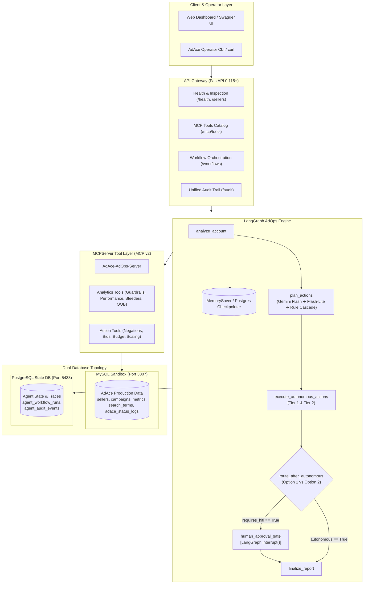
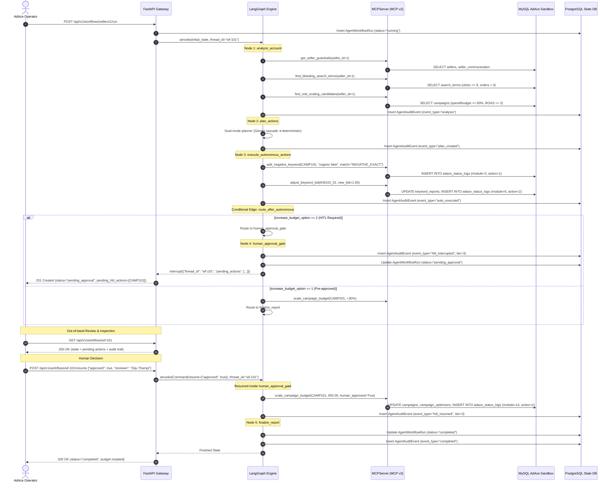
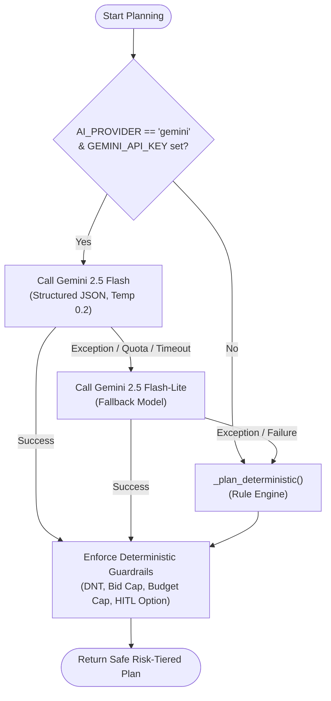

# AdAce Agentic Ops - System Architecture & Engineering Deep-Dive

**AdAce Agentic Ops** is an Enterprise Agentic AI Workflow Automation Platform designed to operate directly on top of the production AdAce Amazon Advertising MySQL schema. It blends **LangGraph state persistence**, **FastMCP / MCPServer (MCP v2) tool interfaces**, a **dual-database topology (MySQL + PostgreSQL)**, and **deterministic Python guardrails** with an asynchronous **Human-in-the-Loop (HITL) interrupt engine**.

---

## 1. High-Level System Architecture

The platform separates volatile agent workflow state and immutable compliance audit trails from live advertising business data.



---

## 2. Dual-Database Hybrid Topology & Data Model Justification

### Why Dual-Database?

| Dimension | AdAce MySQL Sandbox (`adace_mysql`: 3307) | Agent PostgreSQL State DB (`agent_pg`: 5433) |
| :--- | :--- | :--- |
| **Primary Responsibility** | Live Amazon Advertising relational schema & business entities | Agent execution state, thread checkpoints, and immutable audit logs |
| **Data Nature** | Highly structured, transactional, relational schema mirrored from production MariaDB/MySQL | Semi-structured JSONB payloads, thread graph states, and append-only event logs |
| **Key Tables** | `sellers`, `seller_communication_management`, `campaigns`, `campaign_optimizers`, `campaign_metrics`, `keyword_reports`, `search_terms`, `adace_status_logs` | `agent_workflow_runs`, `agent_audit_events` |
| **Isolation & Security** | Read/write scoped strictly to advertising entities; mutations guarded by deterministic safety rules | Ephemeral graph state & operator audit trails; safe from ad campaign schema migrations |
| **Concurrency / ORM** | Async SQLAlchemy 2.0 with `aiomysql` connection pooling | Async SQLAlchemy 2.0 with `asyncpg` and psycopg3 connection pooling |

### Database Schema Interaction

```text
+---------------------------------------------------------------------------------------------------+
|                                      DUAL-DATABASE TOPOLOGY                                       |
+---------------------------------------------------------------------------------------------------+
|  ADACE MYSQL SANDBOX (adace_sandbox @ 3307)         |  AGENT POSTGRESQL (agent_ops @ 5433)         |
|                                                     |                                             |
|  [sellers]                                          |  [agent_workflow_runs]                      |
|    id, max_bid_cap, max_budget_cap, neg_key_limit   |    thread_id (PK), seller_id, status        |
|       │ 1:1                                         |    objective, proposed_plan (JSONB)         |
|       ▼                                             |    pending_hitl_actions (JSONB)             |
|  [seller_communication_management]                  |    execution_summary (JSONB), approved_by   |
|    increase_budget_option (1=Auto, 2=HITL)          |    created_at, updated_at                   |
|       │                                             |       │ 1:N                                 |
|       ▼ 1:N                                         |       ▼                                     |
|  [campaigns] ──1:1── [campaign_optimizers] (dnt)    |  [agent_audit_events]                        |
|       │ 1:N                                         |    id (PK), thread_id, seller_id           |
|       ▼                                             |    node_name, event_type, tier              |
|  [campaign_metrics]                                 |    payload (JSONB), created_at              |
|    spend, sales, orders, roas, acos                 |                                             |
|                                                     |                                             |
|  [adace_status_logs]                                |                                             |
|    before/after budget & bid mutation audit entries |                                             |
+---------------------------------------------------------------------------------------------------+
```

---

## 3. Three-Tier Risk Guardrail Matrix

AdAce implements a strict three-tier defense-in-depth hierarchy. Guardrails are enforced at the **Python application layer**, guaranteeing that LLM recommendations can **never** bypass safety caps.

| Risk Tier | Action Type | Pre-Conditions & Safety Guardrails | Execution Mode | Audit Destination |
| :--- | :--- | :--- | :--- | :--- |
| **Tier 1: Bleeder Negation** | Add Negative Exact Keyword | • Zero orders in 7-day attribution window (`units_sold_clicks_7d == 0`)<br/>• Non-converting clicks >= seller threshold (`neg_key_max_no_orders`)<br/>• Target campaign has `dnt == 0` | **Autonomous** | MySQL `adace_status_logs` (`module_id=3`, `action_id=1`) + PostgreSQL `AgentAuditEvent` |
| **Tier 2: Bounded Bid Scale** | Adjust Keyword Bid | • Campaign has `dnt == 0`<br/>• ROAS >= 3.5 and campaign ACOS < target ACOS<br/>• Proposed bid <= `max_bid_cap`<br/>• Single-step bid increase <= 20% (`new_bid <= cur_bid * 1.20`) | **Bounded Autonomous** | MySQL `adace_status_logs` (`module_id=6`, `action_id=2`) + PostgreSQL `AgentAuditEvent` |
| **Tier 3: Budget Scaling** | Scale Campaign Daily Budget | • Campaign spend utilization >= 80% (`spend / budget >= 0.80`)<br/>• Strong efficiency: ROAS >= 3.0<br/>• Target campaign has `dnt == 0`<br/>• Scaled budget <= `max_budget_cap`<br/>• Standard step increase: +30% | **HITL Guardrailed**<br/>• Option 1: Autonomous Pre-approved<br/>• Option 2: True HITL Suspend (`interrupt()`) | MySQL `adace_status_logs` (`module_id=14`, `action_id=2`, `rule='OOB 3xRoAS'`) + PostgreSQL `AgentAuditEvent` |

---

## 4. LangGraph StateGraph & True HITL Interrupt Engine

The platform leverages LangGraph's native `interrupt()` and `Command(resume=...)` to manage long-lived Human-In-The-Loop approvals. When a seller requires human review (`increase_budget_option != 1`), the workflow **genuinely suspends execution** at the `human_approval_gate` node.

### End-to-End Execution Sequence Diagram



---

## 5. Resilient Multi-Tier Gemini AI Planning Cascade

When `AI_PROVIDER=gemini` is configured, the planner implements an automated cascading fallback to ensure maximum operational uptime:



### Executive-Grade Rationale Metrics
All generated actions include quantified business rationale:
- **Tier 1:** Immediate dollar waste eliminated (`$cost`) and projected annualized cost avoidance (`$cost * 52`).
- **Tier 2:** ROAS/ACOS efficiency deltas vs target and projected impression share gain within safe bid caps.
- **Tier 3:** Historical spend utilization percentage, ROAS, and projected incremental conversions before hitting budget caps.

---

## 6. Unified Audit Trail & Multi-Tenant Reconciliation

To achieve enterprise compliance, the system merges:
1. **PostgreSQL Event Stream:** Records agent cognitive transitions (`analysis`, `plan_created`, `auto_executed`, `hitl_interrupted`, `hitl_resumed`, `rejected`, `completed`).
2. **MySQL AdAce Status Logs:** Records the exact before-and-after values of all advertising mutations (`campaign_prv_budget` ➔ `campaign_cur_budget`, `keywd_prev_bid` ➔ `keywd_cur_bid`, `neg_keywd_product`).

The `GET /api/v1/audit/sellers/{seller_id}/trail` endpoint normalizes all timestamps to UTC, strictly scopes queries by `seller_id`, and delivers an integrated, chronologically ordered audit ledger.
